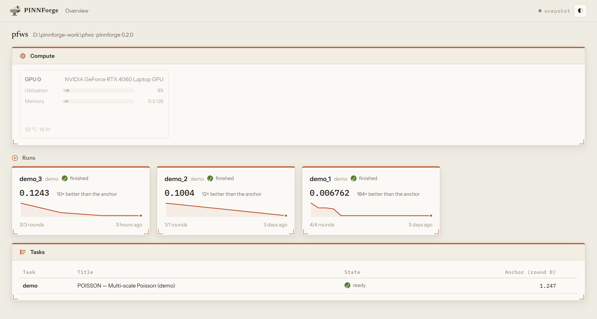
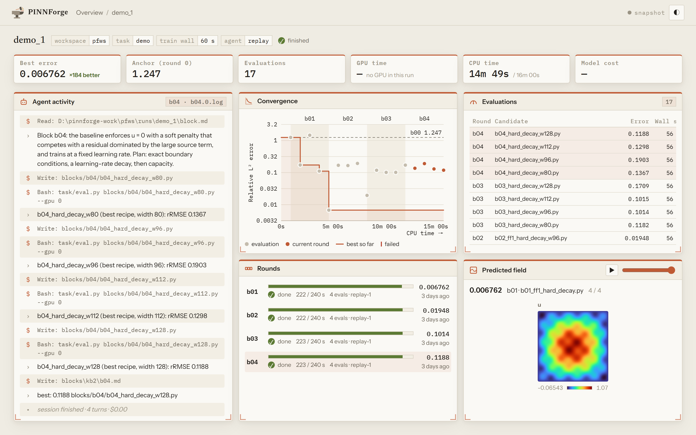

<h1 align="center"> PINNForge</h1>

PINNForge is a knowledge-centric agent system for the autonomous discovery of
physics-informed neural network (PINN) solvers. It pairs two knowledge bases,
which decide what knowledge guides the discovery, with an agent harness, which
decides how that knowledge is used.

## Install

```bash
curl -fsSL https://raw.githubusercontent.com/JiangtaoShen/pinnforge/main/install.sh | sh
```

On Windows, in PowerShell:

```powershell
powershell -ExecutionPolicy ByPass -c "irm https://raw.githubusercontent.com/JiangtaoShen/pinnforge/main/install.ps1 | iex"
```

Both install `pinnforge` from this repository with `uv tool install`. The
`pinnforge` on PyPI is an unrelated project.

Linux with an NVIDIA GPU is the target. macOS and Windows train on the CPU; on
Windows, install inside WSL2 to train on the GPU.

## Quick start

```bash
pinnforge init ~/pf && cd ~/pf     # a workspace, its GPUs, a pinned JAX environment
pinnforge demo                     # a whole run in minutes: a scripted agent, no API key
pinnforge setup                    # choose the coding agent and pin its model
pinnforge task new                 # describe a PDE; without a reference, an agent builds one
pinnforge run start -t <task> -n 5 # five rounds, detached, with a live dashboard
```

`pinnforge doctor` checks the prerequisites.

## Tasks

A task package holds four parts:
* the description, `problem.md`, in seven fixed sections: Equation, Domain,
  Boundary conditions, Initial condition, Scoring, Environment, Time budget;
* the standard PINN, `baseline.py`: a frozen `PDE CONSTANTS` header with the
  training time, `train(rng, eval_callback=None) -> (params, step_count)` and
  `predict_fn(params, X) -> dict`;
* the public files;
* the evaluation tool, `eval.py`: grid handling and the metric,
  `score_predictions(fields, ref_dir) -> {"rRMSE": x}`.

Its `view.json` says what the dashboard's field panel draws, and its reference
solution stays in `private/`.

```bash
pinnforge task new burgers --describe "u_t + u u_x = 0.01/π u_xx on [-1,1]×[0,1], u(x,0) = -sin(πx), u(±1,t) = 0"
pinnforge task new ldc2 --describe @spec.md --reference ~/data/ldc.mat
pinnforge examples add ldc ks cyl naca           # the benchmark tasks, with their references
pinnforge task delete ldc2
```

An author agent writes the package without seeing the reference solution.
A reference that an agent builds is computed at several resolutions and
checked for convergence. Authors are audited, and `pinnforge task validate`
checks that every package has this form and holds nothing of the reference.

## Runs

```bash
pinnforge run start -t ldc -n 5 --budget 3600    # GPU seconds per round
pinnforge run status ldc_1
pinnforge run stop ldc_1
pinnforge run resume ldc_1
pinnforge run audit ldc_1                        # did any round alter another's record
pinnforge run film ldc_1                         # make its discovery film again
pinnforge run delete ldc_1
```

A run starts with round 0, the standard PINN trained once, which is the anchor
the run measures progress against. In each round, a new coding agent:
* reads the charter, the literature base and the experience base;
* redesigns the solver;
* evaluates its candidates within the round's GPU budget;
* writes a summary into the experience base.

The run returns the candidate with the lowest error. When the run is over, its
agent writes the script of a discovery film, which a fixed player renders into
`runs/<id>/discovery.html`.

`pinnforge setup gpus` chooses the cards a workspace uses, and
`run start --gpus` overrides the choice for one run.

## The dashboard

`pinnforge ui` shows a workspace's GPUs, runs and tasks.



A run fits on one screen, as it happens. It shows the agent's actions, the
error of every evaluation against GPU time, the rounds, the evaluations, and
the predicted field of the incumbent.



## Agents

| runtime | CLI | default model |
|---|---|---|
| `claude_code` | `claude` | `claude-opus-4-8` |
| `codex` | `codex` | `gpt-5.4` |
| `cursor_agent` | `cursor-agent` | `auto` |
| `opencode` | `opencode` | none; name one |

`pinnforge setup` pins an exact model id and pings it. The model each round
actually ran is recorded.

`pinnforge chat` opens Claude Code with the PINNForge plugin; see
`plugin/README.md` for other agents. Never put an `AGENTS.md`, `CLAUDE.md` or
`.cursor/rules/` in a workspace or above it: the rounds would read it.

## Scoring and integrity

* **Scoring.** The score service is the only process that reads the reference
  solution. It returns the relative L² error and nothing else, never runs the
  agent's code, and caps its requests per round.
* **The record.** Before each round, the orchestrator hashes everything the
  round must leave unchanged, and `pinnforge run audit` reports any change.
* **The dashboard.** It is read-only, and serves nothing of the reference
  solution.
* **Isolation.** To make it an OS fact, keep the references outside the
  workspace (`private_dir:`) and serve them as another user:
  `pinnforge scored <run> --private /srv/answers`.

## Workspace layout

| path | role |
|---|---|
| `pinnforge.yaml` | the workspace's settings: agent, GPUs, budget, private dir, dashboard |
| `.venv/` | the frozen JAX environment every evaluation runs in |
| `tasks/<name>/` | the task library |
| `runs/<task>_<n>/` | one run: its task copy, literature base, rounds, summaries, records, film |
| `.pinnforge/` | locks, score ledgers, dashboard state |

Settings layer as built-in defaults < `~/.config/pinnforge/config.yaml` <
`pinnforge.yaml` < flags < `--set a.b=c`.

## Development

```bash
git clone https://github.com/JiangtaoShen/pinnforge && cd pinnforge
uv sync                       # dev tools and the frozen stack
uv run pytest tests/ -q
uv run ruff check .
```

`tasks/` and `pinnforge/examples/` are left out of lint: their `baseline.py`
and `eval.py` are fingerprinted by the anchor cache.
